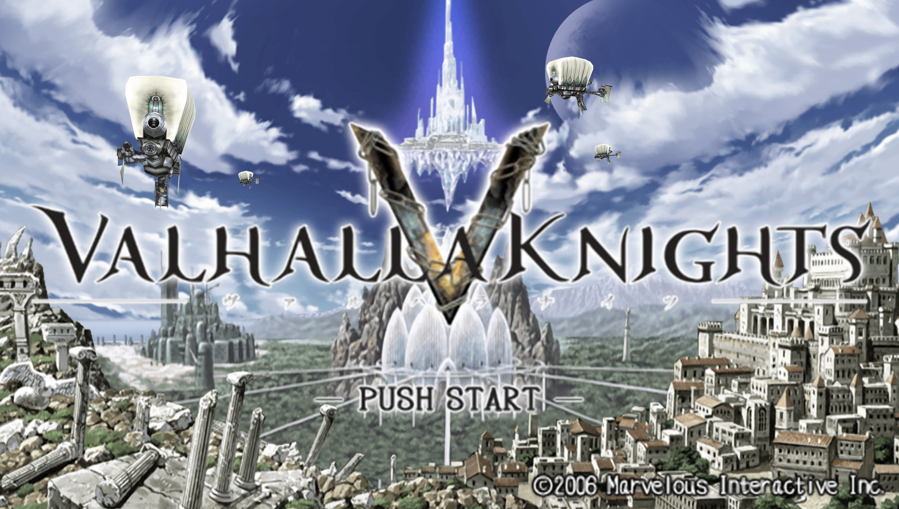

# 발할라 나이츠 — PSP

PSP **발할라 나이츠** 한글 번역 패치 프로젝트입니다. 캐릭터를 육성하며 던전을 탐험하는 액션 RPG입니다.

> **현재 최종 xdelta 배포본**

<!-- game-preview:start -->

  

**타이틀 · 원문 로고** — 사용자가 PPSSPP에서 촬영한 발할라 나이츠 전체 타이틀 화면입니다. 로고와 시작 안내는 원문입니다. 촬영 CHD와 최종 배포 결과 ISO의 해시 대조는 수행하지 않았습니다.
<!-- game-preview:end -->

## 다운로드 및 적용 방법

1. 아래 체크섬 또는 상세 안내와 일치하는 원본을 준비합니다.
2. [최종 배포 패치 다운로드](https://github.com/akuma815/psp-valhalla-knights-kr-patch/releases/tag/release-current)에서 ZIP을 받아 모두 압축 해제합니다.
3. Delta Patcher 등 xdelta 패처에서 원본 ISO와 `Valhalla Knights_Korean_Patch.xdelta`를 선택합니다.
4. 원본을 백업하고 새 ISO로 적용한 뒤 결과 SHA-256을 확인합니다.

## 주의사항

- Valhalla Knights (Korea).iso의 지정 SHA-256과 일치하는 원본 전용입니다.
- 패치 적용 결과는 원본보다 작습니다. 크기와 SHA-256을 함께 확인하세요.
- 기존 배포 안내에는 전체 플레이 검증 완료 여부가 명시되어 있지 않습니다.
- 원본 게임·BIOS 및 패치가 적용된 게임 이미지는 포함하지 않습니다.

## 체크섬

| 구분 | SHA-256 |
| --- | --- |
| 원본 | `6f62cbe6fcab9a35146245a85025725782ad060a2b1f47a400e1477f9b445360` |
| 패치 파일 `Valhalla Knights_Korean_Patch.xdelta` | `9544dfcc0b4a62087f9282f20823524e3b0baf3f2188f25bbc668dc4dee10b67` |
| 패치 후 이미지 | `eaeeee9f4b7cc587ed870a33d9b3cb6fdd18d424566b05e805641756eb147db9` |
| 배포 압축 파일 | `2cd0819acf3fb67331e557cdf10757eadf2380db358998dc64d9179359248c70` |

## 소스 및 작업 기록

[공개 소스 구성과 빌드 전제](docs/SOURCE_GUIDE.md) · [상세 패치 안내](docs/PATCH_GUIDE.txt)

[최종판 소스 재빌드·복원](docs/rebuild/README.md): 공개 소스와 별도 입력으로 전체 3,125개 파일 및 최종 ISO 동일성을 검증했습니다. 공용 Font·Tools와 고정 공개 릴리즈가 필요합니다.

[최신 작업 인계](docs/HANDOFF_2026-10-16.md)
